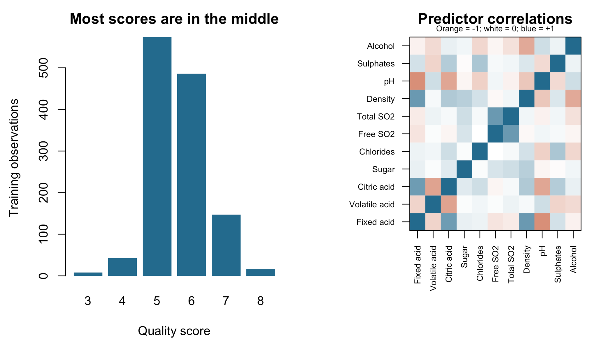
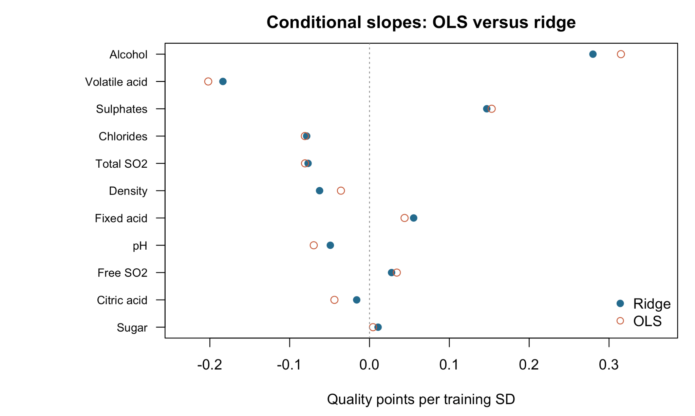
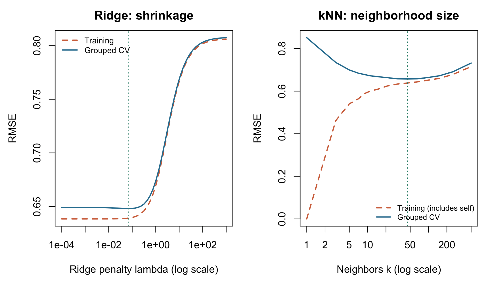
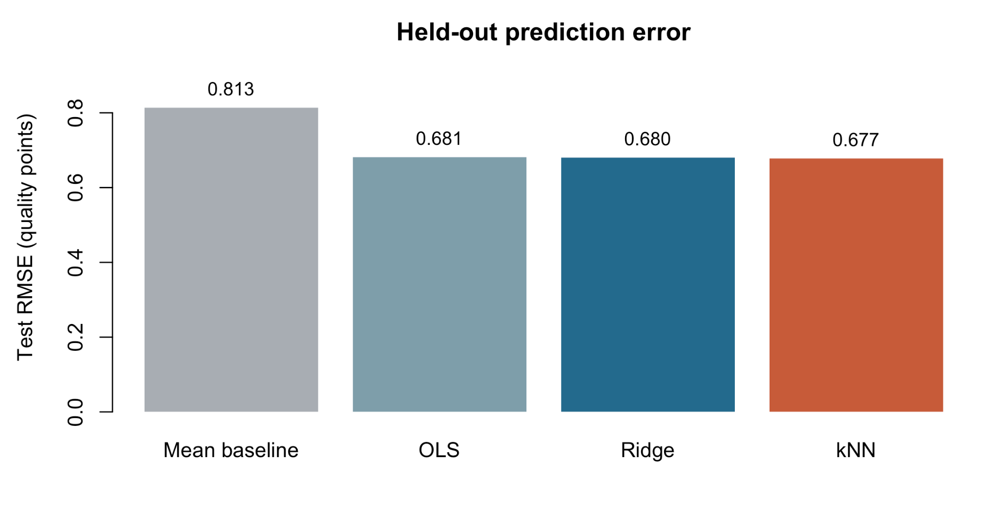
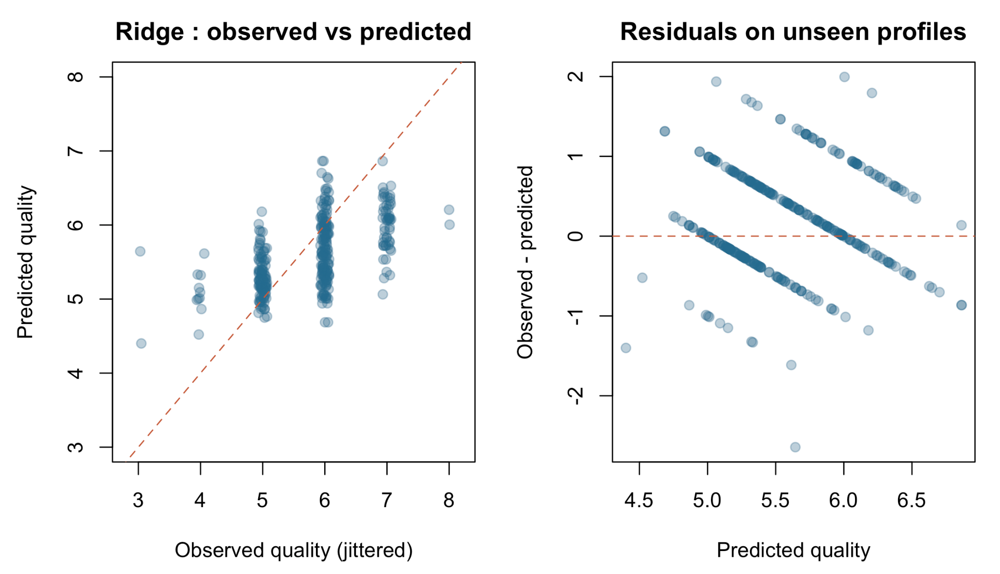

# Predicting Red Wine Quality

## Project Overview

This project uses statistical analysis and machine learning to predict the quality of red wine based on its physicochemical properties.

The analysis uses the UCI Red Wine Quality dataset, containing 1,599 observations and 11 physicochemical predictor variables.

This was an individual data science project completed by Pranav Nadig.

## Models and Performance

Four approaches were evaluated:

- Mean baseline
- Ordinary Least Squares (OLS) regression
- Ridge regression
- K-Nearest Neighbors (kNN) regression

**Held-out test performance**

| Model | Test RMSE |
|---|---:|
| Mean baseline | 0.813 |
| OLS regression | 0.681 |
| Ridge regression | 0.680 |
| kNN regression | 0.677 |

Lower RMSE indicates better predictive performance. All three regression models improved on the mean baseline, with relatively similar results.

## Methodology

- Exploratory data analysis of physicochemical variables
- Correlation analysis to examine relationships between predictors
- OLS and ridge regression modeling
- Ridge penalty and kNN neighborhood-size tuning
- Grouped cross-validation to account for repeated chemical profiles
- Training-fold-only standardization to prevent data leakage
- Held-out test evaluation and residual diagnostics

## Visualizations

### Training Data Exploration


### Model Coefficient Comparison


### Model Complexity and Tuning


### Test Set Model Comparison


### Test Set Diagnostics


## Full Analysis Report

The complete rendered report includes the analysis, methodology, model development, visualizations, and evaluation.

[**View the full HTML report**](report/wine_quality_report.html)

The original R Markdown source is also available:

[`wine_quality_report.Rmd`](wine_quality_report.Rmd)

## Tools and Technologies

- R
- R Markdown
- Statistical modeling
- Machine learning
- Data visualization
- Cross-validation and model evaluation

## Repository Structure

```text
wine-quality-prediction/
├── README.md
├── wine_quality_report.Rmd
├── winequality-red.csv
├── report/
│   └── wine_quality_report.html
└── figures/
    ├── training-exploration-1.png
    ├── coefficient-plot-1.png
    ├── complexity-curves-1.png
    ├── test-comparison-1.png
    └── test-diagnostics-1.png
```

## Key Takeaways

- Physicochemical measurements can provide useful signals for predicting red wine quality.
- Regression models substantially improved prediction over the mean baseline.
- Ridge regression and kNN performed similarly to OLS on the held-out test set.
- Careful validation and prevention of data leakage are important when evaluating predictive models.

## Dataset

Source: [UCI Machine Learning Repository – Wine Quality Dataset](https://archive.ics.uci.edu/dataset/186/wine+quality)

Dataset attribution is retained to acknowledge the original source.
